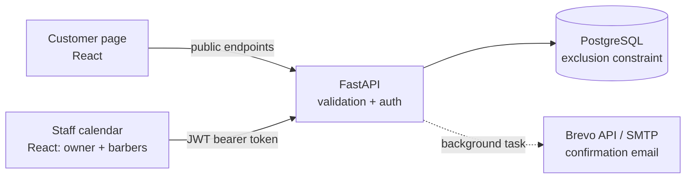

# North Street – Barber Booking System

[](https://github.com/musee-00/booking-system/actions/workflows/ci.yml)

A full-stack booking system for barbershops, built as a self-hosted alternative to tools like Setmore. Customers book a service with a barber online. The barber manages the schedule in a password-protected admin calendar.

**Live demo:** https://north-street-booking.vercel.app

> Runs on free tiers: the first request after a quiet period can take up to a minute while the API wakes up. See [DEPLOYMENT.md](DEPLOYMENT.md).

**Stack:** Python · FastAPI · PostgreSQL · SQLAlchemy · Alembic · React · Vite · JWT · pytest

---

## Features

**Customers**
- Book in a five-step wizard: service → barber → time → details → confirm. Steps that are already answered are skipped (for example when booking from a barber's profile).
- Only see barbers who offer the chosen service, and only real free times: inside that barber's working hours (shop open Tue–Sat 09:00–18:00, Stockholm time), not during their breaks or time off, and not overlapping existing bookings.
- Get a confirmation screen and email with service, barber, time, price, address and a booking reference.
- Cancel their own booking without logging in, through a secret link in the email (until 2 hours before), and get a cancellation email.

**Owner** (like Setmore's "Admin" access level)
- Calendar with week and day views and one colour per barber. Breaks, days off and time off are hatched (day view per barber; week view when nobody works). Past slots and closed days are greyed out; completed and cancelled appointments can be shown or hidden.
- Create and cancel bookings from the calendar. A cancelled time becomes bookable again right away.
- **Team & services** page:
  - add, edit, deactivate or reactivate barbers and services (deactivating keeps booking history);
  - choose which barbers offer each service ("Offered by");
  - set each barber's weekly hours with a lunch break, and add time off (whole days or part of a day). Existing bookings that clash are listed, never cancelled automatically;
  - create, reset or remove each barber's own login.

**Everyone**
- Light and dark mode: follows the device's setting until the visitor picks one with the ☀/☾ button, then remembers it. All colours are CSS custom properties (design tokens) switched by a `data-theme` attribute, set before the page draws so there's no flash of the wrong theme.

**Barber** (like Setmore's "Standard" access level)
- Logs in with their own account and sees and manages **only their own calendar**: their own bookings, which they can create and cancel. Services, hours, other barbers and accounts stay with the owner.

---

## Architecture



| Folder | Contents |
|---|---|
| [`backend/`](backend/) | FastAPI app, SQLAlchemy models, Alembic migrations, pytest suite |
| [`frontend/`](frontend/) | React + Vite app: customer page and admin calendar |

---

## How double bookings are prevented

Two customers can never book the same barber at overlapping times. The rule is enforced in **two layers**:

**1. API check, which gives a clear error.** Before saving, the API looks for an active booking for the same barber that overlaps the requested time. If it finds one, it returns **`409 Conflict`** with a readable message.

**2. Database constraint, which is the guarantee.** PostgreSQL rejects overlapping rows itself, using an exclusion constraint:

```sql
ALTER TABLE appointments
ADD CONSTRAINT appointments_no_overlap
EXCLUDE USING gist (
    barber_id WITH =,
    tstzrange(starts_at, ends_at, '[)') WITH &&
) WHERE (status <> 'cancelled');
```

In words: no two non-cancelled rows may have the same `barber_id` (`=`) **and** overlapping time ranges (`&&`).

**Why both layers?** The API check alone has a race condition. If two requests for the same time arrive at the same moment, both can check "is it free?" before either has saved. The database constraint is checked atomically inside the transaction, so only one of the two can be stored. The API catches the constraint violation (`IntegrityError` on `appointments_no_overlap`) and returns the same `409`, so the customer always gets a clear answer.

This isn't just theory. In a test sending **10 identical bookings in parallel**, 9 of them got past the API check. Without the constraint, that would have been 10 bookings for one slot. With it, the result is 1 × `200` and 9 × `409`. Both cases are covered by tests: `test_concurrent_bookings_for_same_slot_only_one_succeeds` and `test_database_constraint_returns_409_when_api_check_is_bypassed`.

**Back-to-back bookings are allowed.** Time ranges are *half-open*, `[start, end)`. The start time is included, the end time is not. So 10:00–10:30 and 10:30–11:00 don't overlap. The API uses the same rule with strict comparisons:

```python
Appointment.starts_at < requested_end and Appointment.ends_at > requested_start
```

Cancelled bookings are excluded in both layers, so cancelling a booking frees the slot again.

---

## Security

Staff endpoints require a **JWT** in the `Authorization: Bearer <token>` header. The token comes from `POST /api/v1/admin/login`, is signed with `JWT_SECRET` and expires after `JWT_ACCESS_TOKEN_EXPIRE_MINUTES`. Passwords are stored as **bcrypt** hashes.

**Authentication and authorization are two separate FastAPI dependencies:**
- `get_current_user` answers *who are you?* It returns `401` (with `WWW-Authenticate: Bearer`) for a token that is missing, malformed, expired or forged, and for a barber whose account was removed or who was deactivated.
- `require_owner` answers *may you do this?* It returns `403` for a barber calling an owner-only endpoint.

The role is read from the database on every request, not from the token, so removing a login or deactivating a barber locks them out immediately. A barber who asks for a colleague's booking gets `404`, the same answer as for a booking that doesn't exist, so they can't learn that it exists. The frontend hides owner screens from barbers, but that's only presentation: the API enforces every rule, and a test calls every owner-only endpoint with a barber's token. In the staff UI, any `401` clears the stored session and redirects to the login page with a "session expired" message.

| Method | Endpoint | Access | Returns |
|---|---|---|---|
| GET | `/api/v1/health` | Public | Status |
| GET | `/api/v1/services` | Public | Active services |
| GET | `/api/v1/barbers` | Public | Active barber profiles |
| GET | `/api/v1/availability?barber_id&service_id&date` | Public | Free slots (times and barber only) |
| POST | `/api/v1/appointments` | Public | The booking just created |
| GET | `/api/v1/manage/{token}` | Secret link | The customer's own booking and whether it can still be cancelled |
| POST | `/api/v1/manage/{token}/cancel` | Secret link | Cancels it (until `CUSTOMER_CANCEL_CUTOFF_HOURS` before) |
| POST | `/api/v1/admin/login` | Public | JWT, role and barber id |
| GET | `/api/v1/auth/me` | Staff | Who is logged in |
| GET | `/api/v1/appointments` | Staff | Owner: all bookings with customer contact details. Barber: only their own |
| PATCH | `/api/v1/appointments/{id}/cancel` | Staff | Cancelled booking (a barber only their own; otherwise `404`) |
| GET | `/api/v1/admin/barbers`, `/api/v1/admin/services` | Staff | All barbers and services, including inactive |
| GET | `/api/v1/barbers/schedules?start&end` | Staff | Hours and time off for the calendar (a barber only their own) |
| POST, PATCH | `/api/v1/barbers`, `/api/v1/barbers/{id}` | **Owner** | Created or updated barber (partial update, including `active`) |
| POST, PATCH | `/api/v1/services`, `/api/v1/services/{id}` | **Owner** | Created or updated service, including who offers it (`barber_ids`) |
| GET, PUT | `/api/v1/barbers/{id}/working-hours` | **Owner** | Weekly hours; `PUT` replaces them and lists bookings now outside them |
| GET, POST, DELETE | `/api/v1/barbers/{id}/time-off` | **Owner** | Time off; `POST` lists bookings inside the new period |
| GET, POST, PUT, DELETE | `/api/v1/accounts` | **Owner** | Barber logins: list, create, reset password, remove |

No public endpoint returns another customer's personal data, and a test checks this.

**Customer self-service links.** Each booking gets a token from `secrets.token_urlsafe(32)` (256 bits, so it can't be guessed the way a booking id could). Only its SHA-256 hash is stored, like a password, so a copy of the database can't be used to build links; the plain token only appears in the customer's email. A plain hash is enough here (bcrypt is for passwords) because the token is already long and random.

**Barbers and services are never deleted, only deactivated** (`active = false`). Appointments reference them with foreign keys, so a hard delete would either fail or destroy booking history. An inactive barber or service is hidden from customers and can't be booked, but old appointments keep it, and it can be reactivated. Interactive API docs with an **Authorize** button are available at `http://localhost:8000/docs`.

---

## Running locally

**Requirements:** Python 3.12+, Node 20+, PostgreSQL 14+ (`btree_gist` is used and ships with PostgreSQL).

### 1. Database
```bash
createuser booking_user --pwprompt     # password used in .env, e.g. booking_password
createdb booking_db --owner booking_user
```

### 2. Backend
```bash
cd backend
python3 -m venv .venv
source .venv/bin/activate
pip install -r requirements.txt
cp .env.example .env                   # then edit values, see "Configuration"
alembic upgrade head                   # create tables + the overlap constraint
python scripts/seed_dev_data.py        # optional demo data (wipes existing bookings!)
uvicorn app.main:app --reload          # http://localhost:8000
```

### 3. Frontend
```bash
cd frontend
npm install
npm run dev                            # http://localhost:5173
```

The customer page is at `/`. The admin login is at `/admin`, or via **Staff login** in the footer.

### 4. Tests
```bash
cd backend
source .venv/bin/activate
python -m pytest -v
```
The test suite creates a separate `booking_test_db`, runs all migrations on it and drops it afterwards. **GitHub Actions** runs the same tests against a real PostgreSQL 16 on every push, plus the frontend lint and build ([`.github/workflows/ci.yml`](.github/workflows/ci.yml)). Email sending is mocked. Among other things, the tests cover:
- overlap and back-to-back bookings
- 10 parallel bookings for the same slot (exactly one succeeds)
- slots reopening after cancellation
- past bookings being rejected
- 401 on every protected endpoint for missing, garbage, expired and forged tokens
- no customer data in public responses

---

## Configuration

All settings are read from `backend/.env`. See [`backend/.env.example`](backend/.env.example).

| Variable | Purpose |
|---|---|
| `APP_ENV` | `development` or `production`. In production the API **refuses to start** with default or weak secrets, or with a localhost CORS origin |
| `DATABASE_URL` | PostgreSQL connection string (`postgres://…` from hosts like Render is converted automatically) |
| `TEST_DATABASE_URL`, `TEST_DATABASE_ADMIN_URL` | Test database, and a connection allowed to create and drop it |
| `ADMIN_USERNAME`, `ADMIN_PASSWORD` | Admin account (created on first login if missing) |
| `JWT_SECRET` | Token signing key. **Use a long random value in production**: `python -c "import secrets; print(secrets.token_urlsafe(48))"` |
| `JWT_ACCESS_TOKEN_EXPIRE_MINUTES` | Token lifetime |
| `BREVO_API_KEY` | Production email: send through Brevo's HTTPS API (Render's free tier blocks SMTP) |
| `SMTP_*` | Local email server; `SMTP_FROM_EMAIL` is also the sender address for Brevo |
| `EMAIL_REPLY_TO` | Where customer replies go (defaults to `SMTP_FROM_EMAIL`) |
| `SHOP_NAME`, `SHOP_ADDRESS` | Shown in confirmation emails |
| `CORS_ORIGINS` | Comma-separated frontend URLs allowed to call the API, e.g. `https://your-app.vercel.app` |

The frontend reads one build-time variable, `VITE_API_URL`: the backend's address, without `/api/v1`. It defaults to `http://localhost:8000`. See [`frontend/.env.example`](frontend/.env.example).

### Confirmation emails

Emails are sent as a FastAPI **background task**, after the booking is saved and the response is returned. A slow or failing mail provider never blocks or breaks a booking; failures are logged with the provider's reason.

`app/mailer.py` picks how to send from the settings:

| Setting | Delivery | Used |
|---|---|---|
| `BREVO_API_KEY` set | HTTPS POST to Brevo's transactional email API | In production: Render's free tier blocks SMTP ports |
| `SMTP_HOST` set | SMTP | Locally, e.g. Gmail or Mailpit |
| Neither | Not sent | Tests and setups without email |

Brevo setup for production is in [DEPLOYMENT.md](DEPLOYMENT.md#confirmation-emails-with-brevo).

To send through Gmail locally:
1. Turn on 2-step verification on the Google account.
2. Create an **App password** (Google Account → Security → App passwords).
3. Set the following in `.env`:
   ```
   SMTP_HOST="smtp.gmail.com"
   SMTP_PORT=587
   SMTP_USE_TLS=true
   SMTP_USERNAME="you@gmail.com"
   SMTP_PASSWORD="<16-character app password>"
   SMTP_FROM_EMAIL="you@gmail.com"
   ```

For local development without sending real email, use [Mailpit](https://mailpit.axllent.org/) (`SMTP_HOST=localhost`, `SMTP_PORT=1025`, `SMTP_USE_TLS=false`). The settings are already in `.env.example`.

> **Deliverability note:** a personal Gmail address can't be authenticated (SPF, DKIM, DMARC prove a *domain* may send). Over SMTP such mail often lands in Junk at Outlook / Microsoft 365, and Brevo rewrites the sender to "via brevosend.com" so it passes Gmail's and Yahoo's sender rules. A real shop would authenticate its own domain in Brevo; no code change is needed.

---

## Deployment

The API and PostgreSQL run on **Render** (defined in [`render.yaml`](render.yaml)), and the frontend on **Vercel**. Database migrations run automatically on every deploy, and in production the API refuses to start with default secrets. The step-by-step guide and the free-tier limitations (cold starts, no SMTP, 30-day database) are in [DEPLOYMENT.md](DEPLOYMENT.md).

---

## Known limitations and next steps

- **Not built yet:**
  - letting customers move (not just cancel) their booking through the link
  - a reminder email the day before
  - automated frontend tests in the repository (the flows were verified with headless-browser scripts during development)
