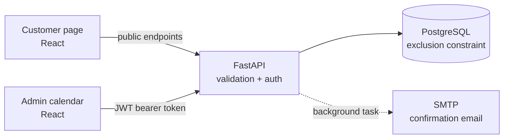

# North Street – Barber Booking System

A full-stack booking system for barbershops, built as a self-hosted alternative to tools like Setmore. Customers book a service with a barber online. The barber manages the schedule in a password-protected admin calendar.

**Live demo:** _coming soon (Render + Vercel)_

**Stack:** Python · FastAPI · PostgreSQL · SQLAlchemy · Alembic · React · Vite · JWT · pytest

---

## Features

**Customers**
- Book in a five-step wizard: service → barber → time → details → confirm. Steps that are already answered are skipped (for example when booking from a barber's profile).
- See only real free times, based on service length, opening hours (Tue–Sat, 09:00–18:00, Stockholm time) and existing bookings.
- Get a confirmation email with service, barber, time, price and address.

**Barber (admin)**
- Log in with a JWT-based admin login.
- Use a calendar with week and day views and one colour per barber.
- Create and cancel bookings from the calendar. A cancelled time becomes bookable again right away.
- Past time slots are greyed out. Completed and cancelled appointments are hidden by default, with toggles to show them.

---

## Architecture



| Folder | Contents |
|---|---|
| [`backend/`](backend/) | FastAPI app, SQLAlchemy models, Alembic migrations, pytest suite |
| [`frontend/`](frontend/) | React + Vite app: customer page and admin calendar |

---

## How double bookings are prevented

Two customers can never book the same barber at overlapping times. The rule is enforced in **two layers**:

**1. API check, which gives a clear error.** Before saving, the API looks for an active booking for the same barber that overlaps the requested time. If it finds one, it returns **`409 Conflict`** with a readable message.

**2. Database constraint, which is the guarantee.** PostgreSQL rejects overlapping rows itself, using an exclusion constraint:

```sql
ALTER TABLE appointments
ADD CONSTRAINT appointments_no_overlap
EXCLUDE USING gist (
    barber_id WITH =,
    tstzrange(starts_at, ends_at, '[)') WITH &&
) WHERE (status <> 'cancelled');
```

In words: no two non-cancelled rows may have the same `barber_id` (`=`) **and** overlapping time ranges (`&&`).

**Why both layers?** The API check alone has a race condition. If two requests for the same time arrive at the same moment, both can check "is it free?" before either has saved. The database constraint is checked atomically inside the transaction, so only one of the two can be stored.

**Back-to-back bookings are allowed.** Time ranges are *half-open*, `[start, end)`. The start time is included, the end time is not. So 10:00–10:30 and 10:30–11:00 don't overlap. The API uses the same rule with strict comparisons:

```python
Appointment.starts_at < requested_end and Appointment.ends_at > requested_start
```

Cancelled bookings are excluded in both layers, so cancelling a booking frees the slot again.

---

## Security

Admin endpoints require a **JWT** in the `Authorization: Bearer <token>` header. The token comes from `POST /api/v1/admin/login`, is signed with `JWT_SECRET` and expires after `JWT_ACCESS_TOKEN_EXPIRE_MINUTES`. Passwords are stored as **bcrypt** hashes.

The check is a single FastAPI dependency, `require_admin`. It is attached to each protected route and returns `401` (with `WWW-Authenticate: Bearer`) for a token that is missing, malformed, expired or forged. In the admin UI, any `401` clears the stored token and redirects to the login page with a "session expired" message.

| Method | Endpoint | Access | Returns |
|---|---|---|---|
| GET | `/api/v1/health` | Public | Status |
| GET | `/api/v1/services` | Public | Services |
| GET | `/api/v1/barbers` | Public | Barber profiles |
| GET | `/api/v1/availability?barber_id&service_id&date` | Public | Free slots (times and barber only) |
| POST | `/api/v1/appointments` | Public | The booking just created |
| POST | `/api/v1/admin/login` | Public | JWT |
| GET | `/api/v1/appointments` | **Admin** | All bookings, including customer contact details |
| POST | `/api/v1/barbers` | **Admin** | Created barber |
| POST | `/api/v1/services` | **Admin** | Created service |
| PATCH | `/api/v1/appointments/{id}/cancel` | **Admin** | Cancelled booking |

No public endpoint returns another customer's personal data, and a test checks this. Interactive API docs with an **Authorize** button are available at `http://localhost:8000/docs`.

---

## Running locally

**Requirements:** Python 3.12+, Node 20+, PostgreSQL 14+ (`btree_gist` is used and ships with PostgreSQL).

### 1. Database
```bash
createuser booking_user --pwprompt     # password used in .env, e.g. booking_password
createdb booking_db --owner booking_user
```

### 2. Backend
```bash
cd backend
python3 -m venv .venv
source .venv/bin/activate
pip install -r requirements.txt
cp .env.example .env                   # then edit values, see "Configuration"
alembic upgrade head                   # create tables + the overlap constraint
python scripts/seed_dev_data.py        # optional demo data (wipes existing bookings!)
uvicorn app.main:app --reload          # http://localhost:8000
```

### 3. Frontend
```bash
cd frontend
npm install
npm run dev                            # http://localhost:5173
```

The customer page is at `/`. The admin login is at `/admin`, or via **Staff login** in the footer.

### 4. Tests
```bash
cd backend
source .venv/bin/activate
python -m pytest -v
```
The test suite creates a separate `booking_test_db`, runs all migrations on it and drops it afterwards. Email sending is mocked. Among other things, the tests cover:
- overlap and back-to-back bookings
- slots reopening after cancellation
- past bookings being rejected
- 401 on every protected endpoint for missing, garbage, expired and forged tokens
- no customer data in public responses

---

## Configuration

All settings are read from `backend/.env`. See [`backend/.env.example`](backend/.env.example).

| Variable | Purpose |
|---|---|
| `DATABASE_URL` | PostgreSQL connection string |
| `TEST_DATABASE_URL`, `TEST_DATABASE_ADMIN_URL` | Test database, and a connection allowed to create and drop it |
| `ADMIN_USERNAME`, `ADMIN_PASSWORD` | Admin account (created on first login if missing) |
| `JWT_SECRET` | Token signing key. **Use a long random value in production**: `python -c "import secrets; print(secrets.token_urlsafe(48))"` |
| `JWT_ACCESS_TOKEN_EXPIRE_MINUTES` | Token lifetime |
| `SMTP_*` | Outgoing email server |
| `SHOP_NAME`, `SHOP_ADDRESS` | Shown in confirmation emails |

### Confirmation emails (Gmail SMTP)

Emails are sent as a FastAPI **background task**, after the booking is saved and the response is returned. A slow or failing mail server never blocks or breaks a booking; failures are logged.

To send through Gmail:
1. Turn on 2-step verification on the Google account.
2. Create an **App password** (Google Account → Security → App passwords).
3. Set the following in `.env`:
   ```
   SMTP_HOST="smtp.gmail.com"
   SMTP_PORT=587
   SMTP_USE_TLS=true
   SMTP_USERNAME="you@gmail.com"
   SMTP_PASSWORD="<16-character app password>"
   SMTP_FROM_EMAIL="you@gmail.com"
   ```

For local development without sending real email, use [Mailpit](https://mailpit.axllent.org/) (`SMTP_HOST=localhost`, `SMTP_PORT=1025`, `SMTP_USE_TLS=false`). The settings are already in `.env.example`.

> **Deliverability note:** mail sent from a personal Gmail address often lands in Junk at Outlook / Microsoft 365 recipients, because the sender has no verified domain. A production setup would use a transactional email service (for example Resend or Postmark) with a custom domain and SPF, DKIM and DMARC records. The code uses plain SMTP, so switching only changes `SMTP_*` settings.

---

## Known limitations and next steps

- **Concurrent bookings:** if two requests race past the API check, the database constraint blocks the second one, but the API currently returns `500` instead of `409`. Next step: catch `IntegrityError` and map it to `409`.
- **Before deploying:** the admin login form is pre-filled with demo credentials, and `JWT_SECRET` and `ADMIN_PASSWORD` have development defaults. All of these must be replaced with real secrets in the hosting dashboard.
- **Not built yet:**
  - booking cancellation email
  - appointment status filter
  - frontend tests for the booking wizard
  - deployment to Render (API + PostgreSQL) and Vercel (frontend)
